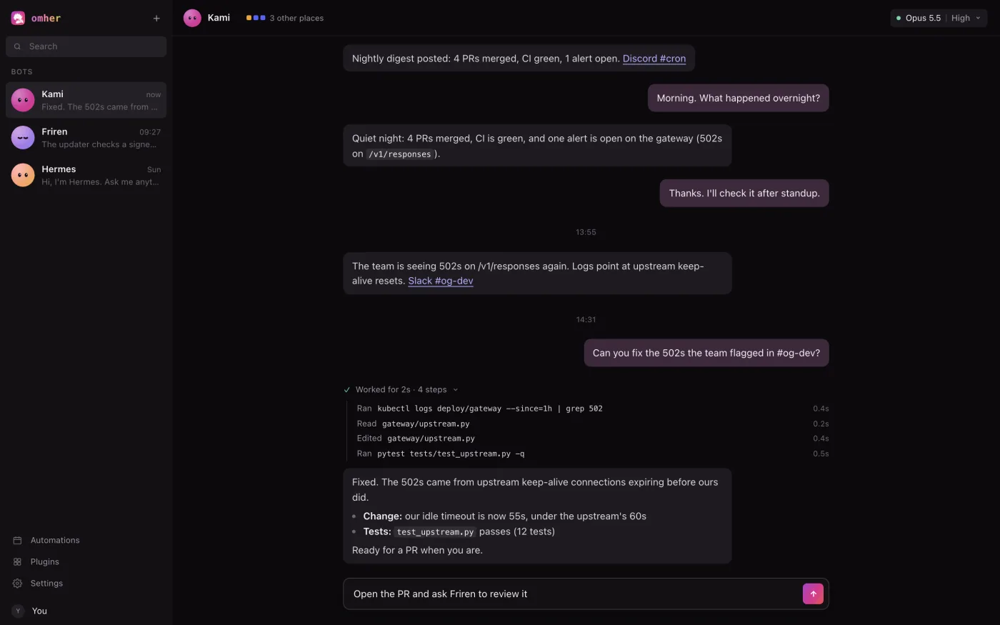

# omher

omher is a desktop app for your Hermes bots, on macOS, Windows and Linux. Each Hermes profile is one bot. Each bot has one main
chat, and the app shows what that bot is doing in its other sessions (Slack, Discord, Telegram, cron)
read-only. Under the bots, SESSIONS starts a coding agent (Claude Code, Codex, OmO, OpenCode, Gemini CLI and more, oh-my-hermes, pi) in a
folder you pick and runs it inside the window, as if you had typed `claude` or `codex` in a terminal. It is part of
this repository but is not part of the `omh` Python package.

Boundary: [`docs/OMHER-BOUNDARY.md`](../../docs/OMHER-BOUNDARY.md).

## Install

**One command (beta).** It installs Hermes Agent and oh-my-hermes if they are missing, then omher
(macOS, Windows and Linux x86_64). Download buttons are on [omher.app](https://omher.app/).

```sh
curl -fsSL https://omher.app/omher | sh
# same as: curl -fsSL https://raw.githubusercontent.com/rlaope/oh-my-hermes/main/install.sh | sh -s -- omher@beta
```

```powershell
irm https://omher.app/omher.ps1 | iex
# same as: & ([scriptblock]::Create((irm https://raw.githubusercontent.com/rlaope/oh-my-hermes/main/install.ps1))) omher@beta
```

The installer copies omher into `/Applications` (or `~/Applications`) on macOS, runs the Windows installer
silently for your user, and on Linux puts the AppImage at `~/.local/bin/omher` with an app menu entry. `OMH_WITH_HERMES=0` skips installing Hermes; `OMH_WITH_DESKTOP=0` skips the app.
Without `omher@beta` the one-liner installs only the `omh` command, as before.



**If you install the app first**, it checks for Hermes on its first launch. When Hermes is missing it shows
"omher needs Hermes and oh-my-hermes" with an **Install** button that runs the same one-liner without the app
(`OMH_WITH_DESKTOP=0`), shows the output, and opens your bots when it finishes. omher needs Hermes only; OMH comes
along because the installer sets both up. This is the only program omher runs besides its bridge
([boundary rule 12](../../docs/OMHER-BOUNDARY.md)).

### Download

omher is open source and ships as plain installers on the
[GitHub Releases page](https://github.com/rlaope/oh-my-hermes/releases?q=omher&expanded=true) (tags `omher-v*`).
There is no App Store build. It runs on [Hermes Agent](https://github.com/NousResearch/hermes-agent) on the same
machine and finds Hermes' Python on its own (see "Where omher looks for Hermes" below); when it finds none, the
first launch offers to install it, as described above.

**macOS (11 or later).** Download `omher-<version>-macos-arm64.dmg` (Apple Silicon) or `-macos-x64.dmg` (Intel),
open it and drag omher into Applications. The app is ad-hoc signed, not notarized, so macOS stops the first
launch of a copy downloaded in a browser with a warning that it cannot check the app. Allow it once:

- **macOS 15 (Sequoia) or later:** close the warning, open **System Settings › Privacy & Security**, scroll down
  to Security and click **Open Anyway** next to omher, then **Open** when the warning comes back. Right-click ›
  Open no longer gets past the warning on these versions.
- **macOS 14 or earlier:** right-click omher in Applications, choose **Open**, then **Open** again.

After that it opens normally. The same thing in one Terminal line, which also helps when macOS says the app
"is damaged":

```sh
xattr -dr com.apple.quarantine /Applications/omher.app
```

The one-line installer above needs neither step: it downloads the same `.dmg` with `curl`, which sets no
download flag.

**Windows 10/11 (x64).** Download `omher-<version>-windows-x64-setup.exe` (installs for your user, no admin) or
the `.msi`. The installer is not code-signed, so SmartScreen may say "Windows protected your PC": choose
**More info**, then **Run anyway**. The installer fetches Microsoft's WebView2 runtime if it is missing.

**Linux (x86_64).** Download `omher-<version>-linux-x64.AppImage`, make it executable and run it:
`chmod +x omher-*.AppImage && ./omher-*.AppImage`. It needs WebKitGTK 4.1 and FUSE 2 (`libfuse2`; Ubuntu 24.04
calls it `libfuse2t64`), which most desktops already have. A `.deb` is on the same release. The in-app update
button replaces the AppImage in place; a `.deb` install is updated by installing the next `.deb` by hand.
Details and troubleshooting: [`docs/omher-linux.md`](../../docs/omher-linux.md).

Check a download against `SHA256SUMS.txt` on the same release:
`shasum -a 256 <file>` (macOS), `sha256sum <file>` (Linux) or `certutil -hashfile <file> SHA256` (Windows).

### Where omher looks for Hermes

1. `OMHER_HERMES_PYTHON`, if set (any Python that can import Hermes).
2. `HERMES_HOME/hermes-agent/venv` (then `.venv`), if `HERMES_HOME` is set.
3. The installer's default home: `~/.hermes/hermes-agent/venv/bin/python` on macOS and Linux,
   `%LOCALAPPDATA%\hermes\hermes-agent\venv\Scripts\python.exe` on Windows.

## Architecture

```
UI (React in a Tauri window)  ⇄  bridge (Python, loopback WebSocket)  ⇄  the person's own Hermes gateway
```

- **UI** (`src/`): talks only to the bridge, through the protocol in `src/lib/protocol.ts`.
- **Shell** (`src-tauri/`): starts the bridge with Hermes' own Python, reads its `OMHER_BRIDGE_READY` line,
  hands the UI a `ws://127.0.0.1:<port>/?token=<random>` URL, and stops the bridge when the app exits. If the
  bridge cannot start, the UI shows the error with a Retry button; if the reason is that Hermes is missing, it
  shows the first-run Install screen instead (`src-tauri/src/setup.rs` holds its one fixed command).
- **Bridge** (`bridge/omher_bridge.py`): uses Hermes' `connect_gateway`, one connection per profile. It binds
  127.0.0.1 only and refuses any connection without the launch token.
- **Mock bridge** (`e2e/mock-bridge.mjs`): the same protocol, scripted, for the Playwright tests.
- **Remote machines over SSH** (`src-tauri/src/peers.rs`, `src/peers/`): the sidebar `+` › Connect over SSH (or the
  chip under a bot's `omher-peer` reply, or Settings › Remote machines) takes a host from `~/.ssh/config` or
  `user@host`, checks it and shows the exact `ssh` command, the Hermes found there and its bots; only Connect saves it
  to `~/.omher/peers.json`. The shell runs the person's own `ssh` with a fixed argv (`BatchMode=yes`, so a key or the
  ssh agent only; a host that wants a password is told to run `ssh-copy-id`), copies omher's bridge to the other
  computer's `~/.omher/peer/` (nothing else is written there) and forwards its loopback port. The local bridge then
  lists that computer's bots as `<peer>:<name>`, marked **SSH · <name>** in the sidebar, header and Settings; folder
  chats and Restart stay on this computer. The link reconnects with backoff when it drops. `BOUNDARY.md` rule 31.
- **Sessions** (`src-tauri/src/sessions.rs`, `src/sessions/`): the SESSIONS `+` opens a menu of the agents found on
  `PATH` and in the usual install folders (`~/.local/bin`, Homebrew, npm/pnpm/bun globals, `%APPDATA%\npm`): the
  installed ones first, the last one used on top, the missing ones dimmed with their install line. Picking one
  opens its New session chat at once; its composer names the agent, and the folder chip under it picks the folder
  (the last one used, else home; recent folders, Choose folder… or home). Nothing runs until the first message, which
  becomes the agent's first prompt; a terminal agent starts on Start. Beside the agent, Chat | Terminal picks how the
  session opens (Chat by default, the last pick remembered per agent): Terminal runs the agent's own program, with no
  arguments, in the pseudo-terminal, and a session opened that way ends with its program and comes back after a
  restart waiting for Resume. DSH is DeepSeek Harness only (the CLI inside its
  app, or the npm package `@deepseek-ai/dsh`; any other `dsh` on PATH is skipped) and opens as a chat: one
  `dsh --profile headless --json` run per message, continued with the harness's `--session-id`. The program runs in a pseudo-terminal (`portable-pty`: a Unix PTY on macOS, ConPTY on
  Windows) drawn with xterm.js. Settings › Terminal picks how every session terminal looks: a theme for the dark app
  theme and one for the light (omher's own two, plus 36 carried over from Orca with their licences in
  `THIRD_PARTY_NOTICES.md`), font, size, line height, cursor, scrollback, contrast and padding, kept on this
  computer (`src/sessions/term/`). In a terminal, Cmd/Ctrl+F finds in the scrollback and Cmd/Ctrl+click opens a web
  link in the browser. The shell reads a program only as far ahead of the terminal as the terminal has drawn (2 MiB
  at most), so a runaway program holds memory flat and Ctrl+C is answered at once. The UI sends only an agent id (`claude`, `codex`, `omo`, `dsh`, `omh`, `pi`, `omp`, `grok`, `opencode`, `gemini`, `qwen`, `kimi`, `copilot`, `cline`); the shell
  refuses anything else and never takes a command line or arguments. Closing a session or quitting the app stops
  the program. In a plain browser (dev, e2e) a mock host echoes what you type instead. A chat session's approvals
  and questions are asks like a bot's: they join the Needs-you strip and ⌘J (named by folder and agent), and the
  session row rings while a turn runs and shows the amber dot while it asks. A row's first line is the session's
  name: the one you gave it (double-click or right-click › Rename), else the title the agent gave the conversation
  (`session_title_changed` from Claude Code, `thread/name/updated` from Codex, `session.title` from Hermes, or the
  bridge's `cli.title` read of their own session files), else a summary of your first message made in the UI
  (`src/sessions/titles.ts`, no model call), else the folder. The second line is the folder and the agent.
- **ACP agents** (`src-tauri/src/acp_chat.rs`): one adapter for agents that speak the Agent Client Protocol
  (JSON-RPC on stdio), one table row per agent. OpenCode (`opencode acp`) is the first. omher turns off the
  protocol's file and terminal capabilities, so the agent uses its own tools; its permission requests become
  approval cards with Deny and Allow once (OpenCode's "Always allow" saves a project rule, so omher does not
  offer it). Before OpenCode starts, omher reads its resolved rules (`opencode agent list`) and starts it with
  ask rules built from them: what you allow asks first, what you deny stays denied. If omher cannot confirm OpenCode
  kept them, it does not start OpenCode. Gemini CLI (`gemini --acp`), Qwen Code (`qwen --acp`), Kimi Code
  (`kimi acp`), Copilot CLI (`copilot --acp`) and Cline (`cline --acp`) are rows of one list in the shell
  (`src-tauri/src/acp_agents.rs`: program, argument, sign-in and install lines, mark), which the agent look-up hands
  to the UI; they use their own approval requests, with no permission override from omher. Their signed-in turns have not been tested. An agent that is not signed in
  ends its session with one line naming its own sign-in command (`gemini`, `kimi login`, `cline auth`, ...) and
  Open in Terminal; omher never signs in for it and never takes a key.
- **Your own ACP agents** (Settings › Agents, `src-tauri/src/custom_agents.rs`): the page lists every offered
  agent read-only with its tier (Main / ACP / Built-in) and whether it is installed, then yours. Add agent takes a
  name, a program (a name on the search path or a full path), its ACP arguments (default `acp`) and an optional
  install line, never a key. Save opens a card with the exact command omher will run, resolved now; only its Add
  writes `~/.omher/custom-agents.json`. The shell checks every entry each time it reads that file and never runs one
  that fails; it starts yours with no shell, through the same ACP adapter, with no rule rewriting, and its session
  says that approvals follow the agent's own settings. Remove ends its open sessions.
- **A bot can draft one; you confirm it.** "Ask the bot" on Settings › Agents only puts a request in the current
  bot's composer. A bot proposes an agent with one fenced block in its reply, which still shows as a code block:

  ````
  ```omher-agent
  {"name": "Cursor Agent", "program": "cursor-agent", "args": ["acp"], "install": "npm install -g @cursor/agent"}
  ```
  ````

  One JSON object; unknown keys are ignored; `args` is a list (default none) and is never split again. Each block
  gets one "Add agent" chip under the reply that opens the same confirm card, with "Proposed by <bot>"; the shell
  checks the draft again (`custom_agent_bot_preview`, no write) and only the card's Add saves it. Bot drafts are
  stricter than the form: a shell, interpreter or launcher program (`sh`, `bash`, `python`, `node`, `env`, `sudo`,
  `open`, `xargs`, ...) or a built-in agent's program is refused, and the chip shows disabled with the reason. Drafts
  are read only from the bot's replies in its main chat and Hermes folder chats, never from tool output, Slack or
  Discord sessions, or a SESSIONS agent's chat.
- **The + menu stays short.** It lists the agents installed on this computer, Claude Code, Codex and OmO (the main
  agents) first, then the other built-ins, then the list's ACP agents; the rest fold under one More agents row, each with its whole install line (a click copies it). Continue a conversation stays under that row, there as
  the menu first opens.

Rules the code keeps:

- **Read-only elsewhere.** `chat.send` reaches only the bot's main chat (the session titled `Bot Chat`). Other
  sessions are listed and their history read, never resumed, answered, interrupted or written to.
- **Files go the same way.** The composer's + (or a drop, or a paste) stages each file with `chat.attach`, which
  calls Hermes' own `image.attach_bytes`, `pdf.attach` or `file.attach` in the main chat, then `chat.send` sends the
  text. 20 files, 100 MB each; if one attach fails, nothing is sent.
- **Loopback only.** The bridge listens on 127.0.0.1 and talks to the gateway Hermes itself runs on this machine.
- **No model calls of its own.** Every model call is Hermes'. omher has no API key and no HTTP client.
- **Sessions run only allow-listed agents.** Only when you start one, only `claude`, `codex`, `omo`, `dsh`, `omh`, `pi`,
  `omp`, `grok`, `opencode`, `gemini`, `qwen`, `kimi`, `copilot` or `cline`, with no arguments besides the fixed chat mode and a conversation id to continue, in the folder you
  picked; stopped when the session is closed or the app quits.
- **Automations and plugins change only through the bot.** The Automations page reads each profile's
  `cron/jobs.json` and changes a job only with that bot's `cron.manage` (add, pause, resume, remove); Run now and
  Edit are chat messages. The Plugins page reads the catalog cache and the profile's plugin folder names and changes
  a plugin only with the bot's `plugins.manage`; installs are catalog-only, inspected first and confirmed.
- **Four languages.** English, Korean, Japanese and Chinese (`src/i18n/`), picked in Settings › General › Language.

## Develop

Needs Node, pnpm, Rust, and Hermes Agent installed (found as described above). Works on macOS and Windows; on
Windows run the commands in Git Bash or PowerShell.

```sh
pnpm install
pnpm dev                  # the UI alone, against VITE_OMHER_BRIDGE or ws://127.0.0.1:5308/?token=dev
node e2e/mock-bridge.mjs --port 5308   # the mock bridge for that
pnpm tauri dev            # the app: starts the real bridge from ./bridge
pnpm typecheck && pnpm test            # tsc, vitest
pnpm e2e                  # Playwright (chromium) against the mock bridge
(cd src-tauri && cargo test)           # the shell's Rust tests
(cd src-tauri && cargo test real_agents_print_their_version -- --ignored --nocapture)  # `claude/codex --version` through the PTY
python -m unittest discover -s bridge/tests -v   # bridge tests with a FakeGateway; needs no Hermes
pnpm tauri build --debug --bundles app # a debug .app in src-tauri/target/debug/bundle/macos/
pnpm tauri build --bundles dmg         # macOS release .dmg (ad-hoc signed)
pnpm tauri build --bundles nsis,msi    # Windows release installers (unsigned)
```

## Release

Bump `version` in `src-tauri/tauri.conf.json` (and `src-tauri/Cargo.toml`, `package.json`), merge, then push a
tag `omher-v<version>`. `.github/workflows/omher-release.yml` builds the macOS (arm64, x64) and Windows (x64)
installers, writes `SHA256SUMS.txt` and attaches everything to a GitHub Release of that tag. No Apple Developer
or Windows signing certificate is involved: macOS builds use an ad-hoc signature (`signingIdentity: "-"`).

## Credits

Agent and CLI marks in `src/assets/agents/` are the projects' own marks, unedited:

- [Lobe Icons](https://github.com/lobehub/lobe-icons) (MIT): Claude Code, Codex, OpenAI, Gemini, Gemini CLI, Grok,
  Grok Bot, Cursor, opencode, Amp, Cline, GitHub Copilot, Goose, Kilo Code, Junie, Qwen, Windsurf, TRAE, Roo Code.
  The model marks in `src/ui/modelMarks.ts` come from the same set.
- pi: `logo-auto.svg` from [pi.dev](https://pi.dev) ([pi-mono](https://github.com/badlogic/pi-mono), MIT).
- omp: the official mark from [omp.sh](https://omp.sh).
- OmO: `omo-icon-light.svg` from [oh-my-openagent](https://github.com/code-yeongyu/oh-my-openagent) (its viewBox
  trimmed to the tile).
- DSH: DeepSeek Harness's `apps/web/public/favicon.svg` from [deepseek-harness](https://github.com/deepseek-ai/deepseek-harness) (MIT), drawn in the text colour.
- OMH: the oh-my-hermes kami mark from this repository.

Each mark belongs to its owner and is used only to name that tool in the app.
